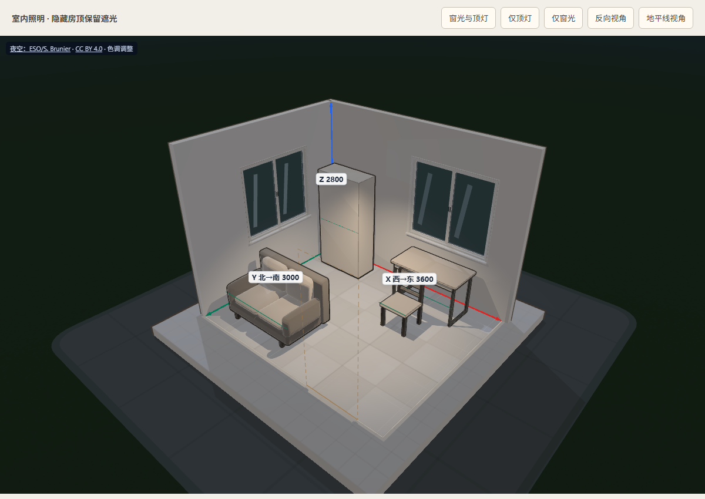
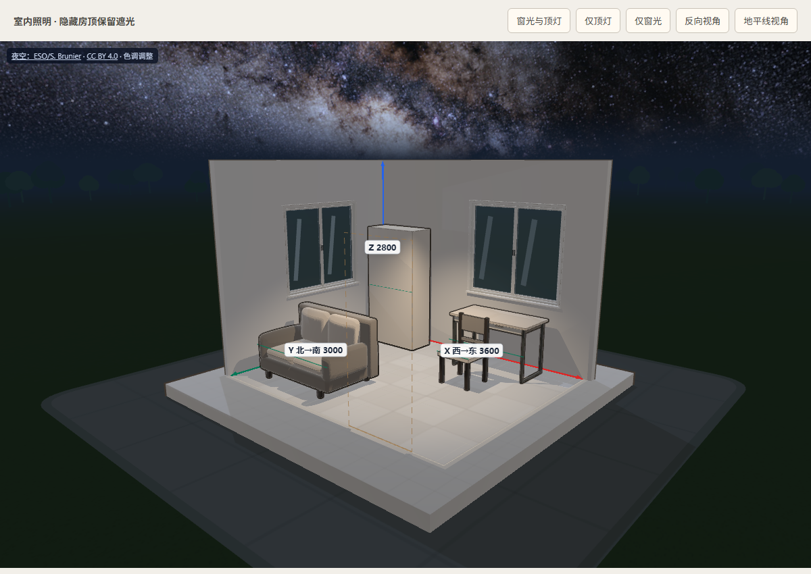

# 三维预览视觉规范

本规范记录用户已确认的房间三维预览风格。新增家具、修复显示问题、重构或重新生成渲染代码时，均须保留这套视觉语言。改变风格须有用户明确要求，并同步更新本规范和参考图。

## 已确认风格

名称：**卡通手办风**，即低多边形卡通着色（Toon / Cel Shading）配合整体轮廓描边。画面应像低饱和配色的建筑模型、小手办，造型简洁，明暗有层次。

关键层次是 **整体外轮廓清晰、有粗细变化，内部结构线细而轻**。外框强调家具整体造型，内部接缝帮助识别扶手、坐垫等结构；不能把每个部件都套成同样粗重的黑框。生产柜体与现成家具使用相同规则：整圈保留基础外框，仅给右下背光侧小幅加重，左上迎光侧不能削成内部细线；离墙后必须恢复整圈可见外框，不能呈现半圈粗、半圈仅剩细线。缩远或缩小画布时随家具投影收细，近看则限制最大线宽，保持卡通手办风的外粗内细层次。

这张图是实际预览截图，用于核对外框、内部线、配色与明暗的关系；不是家具尺寸或几何模板。图中的绿色线属于现有朝向提示，不是卡通描边。

### 沙发软包造型

沙发沿用上述卡通配色与整体描边，软包用圆润曲面表现厚度：坐垫加厚、表面微鼓并有轻微压陷，靠包饱满且上缘后倾，下缘嵌入坐垫。扶手从底座上沿起，侧面微鼓，不能做成从地面竖起的薄板；底座外包边收圆，前后四只木脚支撑离地结构。坐垫包边保持细而轻，扶手和靠包不加多余腰线，不描出曲面的三角网格；不添加密集写实褶皱。

### 写字台造型

现成写字台使用薄圆角桌面、桌下内缩的浅双抽屉和两侧纤细深色框架。抽屉前脸不等分，保留窄分缝和短拉手；桌下中部通透，后横梁保持纤细。沿用低饱和木色、浅色抽屉与统一的外粗内细描边，圆角桌面只画上下边缘，不画曲面离散产生的竖线。

### 门窗造型

门窗沿用建筑模型的低饱和色彩和简洁明暗。门用暖木色门套、带浅凹板和窄压边的关闭门扇，以及小尺寸金属把手、锁片和合页；窗用浅色外框、两扇细框、窄密封条、半透明浅蓝玻璃、克制的反光和向室内伸出的窗台。框体保留墙厚方向的进深，边缘做小倒角，用实体层次表现结构，不逐块套粗黑框。

### 室内照明与隐藏房顶

房顶在布局预览中隐藏以便查看，仍作为实体参与遮光。当前采用夜景：室内由每个实际窗洞的微弱偏冷夜间补光、房间中央靠近顶面的暖色顶灯及少量漫反射补光照亮，以顶灯为主要光源；家具投影来自这些室内光路。窗光经过窗洞、窗框和窗扇遮挡后进入室内，关闭的门保留遮光。当前是统一的预览照明，未增加灯具布置字段，不表示照度计算、太阳方位或完整全局光照模拟。

### 星空与银河背景

星空、室外地面、庭院与远处树影是所有布局项目共用的预览环境，由 Web 渲染入口统一加载。已有项目和新建项目、各房间、编辑页与只读分享页均自动使用这套环境，无须逐项目开启或重新生成布局；环境不写入项目布局数据，不影响尺寸、摆放、确认或冻结结果。

天空使用 [ESO/S. Brunier 的全天银河全景](https://www.eso.org/public/images/eso0932a/)，保留原始星点和银河尘带，映射到随观察中心平移、方向固定的天空球。银河核心放在真实地平线上方，银河斜贯夜空；转动镜头观察不同天空区域，画面不重复平铺。家具继续保持卡通手办风，夜空只作为背景，不直接参与室内采光。窗玻璃使用低透明度冷蓝色和轻反光，透见窗外当前方向的天空或地面；地台保留较弱的冷色展示补光。

按 [ESO 使用条款](https://www.eso.org/public/outreach/copyright/) 和 [CC BY 4.0](https://creativecommons.org/licenses/by/4.0/)，画布左上角保留可见的 **ESO/S. Brunier** 完整署名、原图与许可链接及色调调整说明。维护时不得移除或隐藏署名。

### 室外地面与落地关系

场景采用「石板小院、外围暗绿草地、远处低矮树影、夜间地平线」的建筑模型构图。浅色房屋基座落在圆角石板小院上，外围用窄收边过渡到草地；石板接缝和草纹保持暗而轻，草地与树影随距离逐渐融入地平线的深蓝色，形成薄雾般的远近层次。星空不铺到房屋脚下。沿用原有俯视预设以便查看家具，常规俯视主要看到庭院和草地，压低视角时才看到地平线上方的银河。

下图记录统一家具描边、加入轻重和投影线宽后的实际房间画面，供后续维护核对本次实现；它不替代上方已确认的风格参考。

## 描边与接触的固定效果

- 整体外框连续、深色，整圈保留基础宽度；基础宽度按投影尺寸在 0.85–2.4 CSS 像素内变化，右下背光侧仅乘以 1.0–1.24 的轻重系数。DPR 不改变 CSS 线宽。
- 同件不出现部件粗黑框，不同件交界各画半宽；内部细线保持低对比，透明度 0.45，并防止贴面闪烁。
- 接触墙体或有限地板处消线，移离后恢复；其余部位保留整圈外框。按真实部件接触判断，不能因足迹靠墙而关闭整面描边。门窗洞口无墙处、缩进桌腿与离地坐垫应保留外框。
- 墙体及前景实体应遮挡家具外框，透明墙对应衰减；选择与碰撞继续用橙色和红色反馈。
- 生产家具与现成家具共用上述规则；独立板件页保留结构检查用的板件棱边。

## 修改后的核对

实现归属与渲染顺序见 [页面与模块边界](web-preview.md)，全部命令与覆盖范围见 [检查方法](testing.md)。改描边、接触或遮挡前先核对 [统一 Web 待办](../../../../backlog/web.md)，其中标为未修复的行为仍是已知偏差。

- 有无三角形索引、是否提供包边分别核对；`seamPositions` 不能代表有索引或属于软包。
- 组合核对真实造型、墙地接触、门窗洞口、消线、移离恢复和同件其他部位外框。
- 遮挡检查包含实体内部与交界两侧，扩边后的最终像素也须服从前景遮挡。
- 新回归用例进入统一检查入口；几何测试、蒙版测试各自通过不能替代真实入口组合检查。
- 人工比较近看、远看、旋转、部件交接与交互颜色，保留卡通手办风。测试不能替代审美判断。

风格取舍由用户与维护者依据参考图判断；代码执行确定性几何、蒙版、颜色和遮挡计算，不靠固定文案或关键词判断风格正确。
