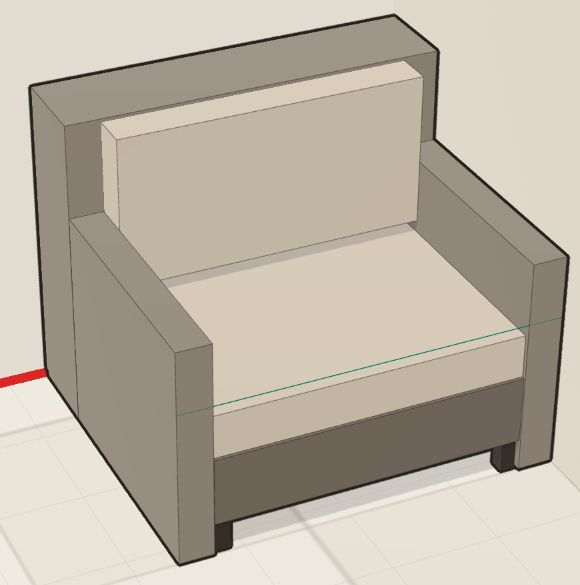
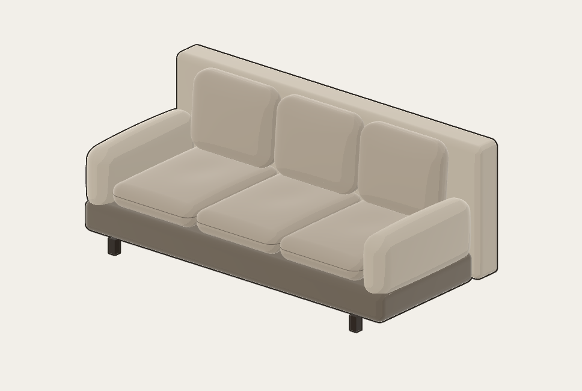
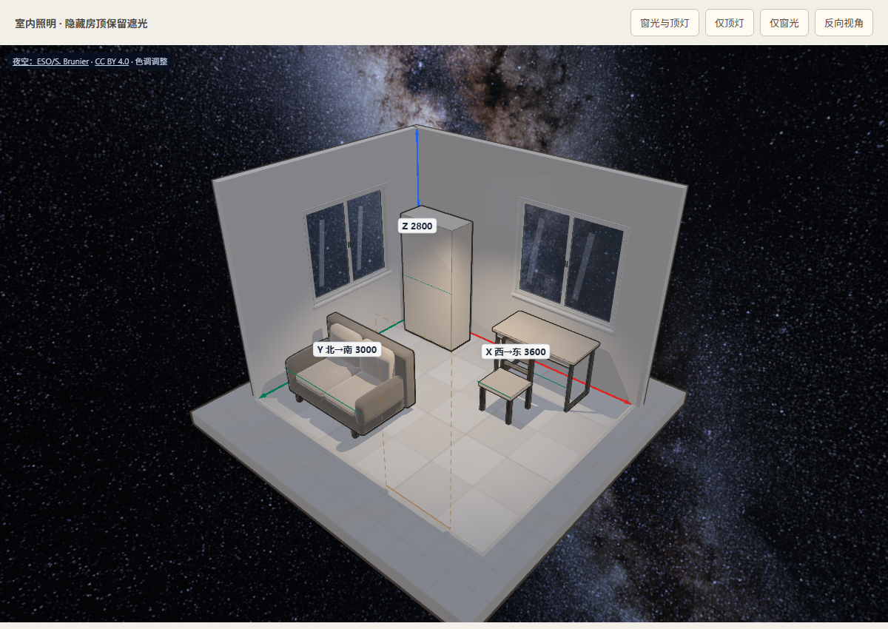
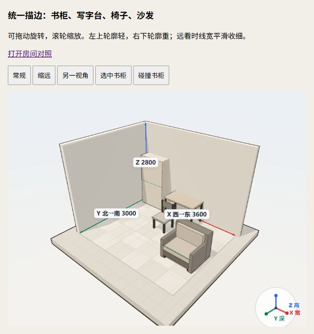
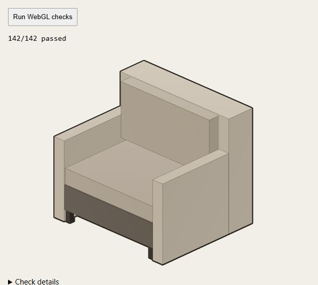

# 三维预览视觉规范

本规范记录用户已确认的房间三维预览风格。新增家具、修复显示问题、重构或重新生成渲染代码时，均须保留这套视觉语言。改变风格须有用户明确要求，并同步更新本规范和参考图。

## 已确认风格

名称：**卡通手办风**，即低多边形卡通着色（Toon / Cel Shading）配合整体轮廓描边。画面应像低饱和配色的建筑模型、小手办，造型简洁，明暗有层次。

关键层次是 **整体外轮廓清晰、有粗细变化，内部结构线细而轻**。外框强调家具整体造型，内部接缝帮助识别扶手、坐垫等结构；不能把每个部件都套成同样粗重的黑框。生产柜体与现成家具使用相同规则：整圈保留基础外框，仅给右下背光侧小幅加重，左上迎光侧不能削成内部细线；离墙后必须恢复整圈可见外框，不能呈现半圈粗、半圈仅剩细线。缩远或缩小画布时随家具投影收细，近看则限制最大线宽，保持卡通手办风的外粗内细层次。



这张图是实际预览截图，用于核对外框、内部线、配色与明暗的关系；不是家具尺寸或几何模板。图中的绿色线属于现有朝向提示，不是卡通描边。

### 沙发软包造型

沙发沿用上述卡通配色与整体描边，软包用圆润曲面表现厚度：坐垫加厚、表面微鼓并有轻微压陷，靠包饱满且上缘后倾，下缘嵌入坐垫。扶手从底座上沿起，侧面微鼓，不能做成从地面竖起的薄板；底座外包边收圆，前后四只木脚支撑离地结构。坐垫包边保持细而轻，扶手和靠包不加多余腰线，不描出曲面的三角网格；不添加密集写实褶皱。



`static/sofa_solid.js` 保留部件尺寸边界，`static/sofa_upholstery.js` 在边界内生成封闭曲面、法线和包边。`static/furniture_edges.js` 给细线与贴墙模块提供相同的真实包边；曲面接触墙而包边未接触时，`wall_contact.js` 另按真实三角面检测接触。尺寸、摆放足迹及制造数据不随曲面改变。

### 写字台造型

现成写字台使用薄圆角桌面、桌下内缩的浅双抽屉和两侧纤细深色框架。抽屉前脸不等分，保留窄分缝和短拉手；桌下中部通透，后横梁保持纤细。沿用低饱和木色、浅色抽屉与统一的外粗内细描边，圆角桌面只画上下边缘，不画曲面离散产生的竖线。

`static/desk_solid.js` 计算部件边界，`static/desk_geometry.js` 在桌面边界内生成圆角实体和真实边缘；`static/layout_meshes.js` 接入相同的点选、选中和碰撞反馈。造型仅用于网页预览，不改变布局足迹或制造数据。运行 `node domain/modules/web/furniture_web/static/desk_solid_check.mjs` 检查部件边界、净空、共面与圆角点选，再用下述浏览器检查核对实际画面。

### 门窗造型

门窗沿用建筑模型的低饱和色彩和简洁明暗。门用暖木色门套、带浅凹板和窄压边的关闭门扇，以及小尺寸金属把手、锁片和合页；窗用浅色外框、两扇细框、窄密封条、半透明浅蓝玻璃、克制的反光和向室内伸出的窗台。框体保留墙厚方向的进深，边缘做小倒角，用实体层次表现结构，不逐块套粗黑框。

`static/opening_models.js` 根据已有洞口计算预览造型，四面墙共用局部坐标并保留 1 mm 以内的贴面间隙，避免与墙洞或地板闪烁。关闭门和双扇窗是统一展示造型，不新增布局字段或开合动作；尺寸、洞口、窗台高度、碰撞和制造数据仍由原阶段拥有。实体全部跟随所属墙淡出，玻璃始终不写深度、不投影；墙体隐藏后继续使用 `opening_markers.js` 的虚线轮廓与悬停提示。

运行 `.venv/Scripts/python.exe domain/modules/web/scripts/check_openings.py`（真实 HTTP/Chromium 须在沙箱外）检查四面墙的安装方向、几何边界、玻璃通透、淡出、资源释放及布局入口重建，在 `temp/opening-checks/` 输出全景、反向、近景和远景截图。预览服务的 `/layout-view/opening_models_browser_check.html` 可手动切换这些视角。

### 室内照明与隐藏房顶

房顶在布局预览中隐藏以便查看，仍作为实体参与遮光。当前采用夜景：室内由每个实际窗洞的微弱偏冷夜间补光、房间中央靠近顶面的暖色顶灯及少量漫反射补光照亮，以顶灯为主要光源；家具投影来自这些室内光路。窗光经过窗洞、窗框和窗扇遮挡后进入室内，关闭的门保留遮光。当前是统一的预览照明，未增加灯具布置字段，不表示照度计算、太阳方位或完整全局光照模拟。

`static/room_lighting.js` 拥有灯光、隐藏房顶和独立遮光墙壳。遮光壳与门窗框独立于视角淡出，颜色与深度均不写入主画面，且不参与家具蒙版、点选或悬停，所以俯视时能看到室内，旋转时也不会因隐藏墙体漏光。墙洞来自已有 `wall_solid.js` 几何，门窗框使用展示实体的独立几何副本。房间或门窗变化时完整重建并释放灯光阴影贴图、遮光几何和专有材质；家具位置、结构或高度变化后重新绘制阴影，单纯换视角复用已有阴影贴图。地台保留场景自身的展示补光，室内材质和家具描边沿用原风格。

主画面保留对数深度以稳定贴面线条。当前 Three.js r186 使用原生阴影深度纹理，聚光灯的透视阴影改用专有 `MeshDepthMaterial` 写投影深度，避免把主画面的对数深度误用于阴影比较而导致整个室内被判为阴影；该调整只作用于投影者的阴影绘制。

在沙箱外运行 `.venv/Scripts/python.exe domain/modules/web/scripts/check_lighting.py`。真实像素检查覆盖夜间窗光/顶灯各自贡献、封窗停止窗光、隐藏房顶挡住上方外光、墙体淡出保留遮光、家具真实投影、无窗房间、移动家具重绘阴影及资源释放，并在 `temp/lighting-checks/` 输出组合照明、仅顶灯、仅窗光和反向视角截图。手动比较入口为 `/layout-view/room_lighting_browser_check.html`；还须运行既有 `check_outline.py` 和 `check_openings.py` 回归。

### 星空与银河背景

天空使用 [ESO/S. Brunier 的全天银河全景](https://www.eso.org/public/images/eso0932a/)，保留原始星点和银河尘带，映射到随观察中心平移、方向固定的天空球。默认视角中银河核心位于房间上方，银河斜贯背景；转动镜头观察不同天空区域，画面不重复平铺。家具继续保持卡通手办风，夜空只作为背景，不直接参与室内采光。窗玻璃使用低透明度冷蓝色和轻反光，窗外可透见星空；地台保留较弱的冷色展示补光。

`layout_diorama.js` 从同源 `static/images/milky-way-eso0932a.jpg` 加载 4000 × 2000 原图，经 `fetch` 和 `createImageBitmap` 解码为共享天空贴图，符合现行页面的 `connect-src 'self'` 内容安全策略。加载完成后自动重绘，不要求用户转动视角；加载前显示深蓝底色，加载错误记录于浏览器控制台。图片随项目提供，运行时不访问 ESO。球面方向与冷色调在渲染时调整，未用 AI 改图；来源、许可与校验值见素材旁的 [说明](../furniture_web/static/images/README.md)。

按 [ESO 使用条款](https://www.eso.org/public/outreach/copyright/) 和 [CC BY 4.0](https://creativecommons.org/licenses/by/4.0/)，`layout_overlay.js` 在画布左上角保留可见的 **ESO/S. Brunier** 完整署名、原图与许可链接及色调调整说明。维护时不得移除或隐藏署名。

`check_lighting.py` 同时验证天空图在生产内容安全策略下成功解码，以及可见来源链接。三套浏览器检查在天空贴图加载完成后截图，保持构图核对一致。



下图记录统一家具描边、加入轻重和投影线宽后的实际房间画面，供后续维护核对本次实现；它不替代上方已确认的风格参考。





## 当前实现与固定口径

| 项目 | 保持的效果 | 当前实现 |
| --- | --- | --- |
| 整体外框 | 连续、深色、有轻重变化，包住每件家具整体 | `static/cartoon_outline.js` 使用颜色和家具身份蒙版，按 `static/outline_style.js` 中的统一规则，以整件包围盒的投影尺寸计算基础线宽（0.85–2.4 CSS 像素），再按轮廓朝向乘以 1.0–1.24 的轻重系数，以半像素过渡柔化边缘；各方向均保留基础外框，不能通过削弱半圈外框制造轻重差异。身份蒙版 alpha 携带共享线宽，DPR 不改变 CSS 线宽。不同家具交界各描半宽，避免合并或叠成双倍粗线 |
| 内部结构线 | 细、低对比，不抢外轮廓 | `static/layout_ink.js` 通过 `furniture_edges.js` 创建硬质棱边或软包包边，透明度由 `outline_style.js` 统一设为 0.45；沿视线拉近 1 mm 防止贴面闪烁 |
| 部件交接 | 没有错位粗黑框、穿插黑块或悬空黑线 | 同件家具共用身份，不同件保留各自边界，不逐块套膨胀描边壳 |
| 遮挡 | 墙及前方实体遮挡家具；透明墙对应衰减轮廓 | 颜色蒙版保留墙体透明度；身份蒙版保留墙后家具身份，避免给家具内部涂黑 |
| 贴墙接触 | 真正接触墙的粗轮廓和细棱边消失，离墙后恢复；其余外框保持粗而清晰 | `static/wall_contact.js` 按部件棱边、软包包边及软包曲面与挖除门窗后的实体墙块求交（0.5 mm 接触公差），裁掉接触细线与颜色蒙版的屏幕扩边范围；身份蒙版不裁空，避免产生内部黑框。完全淡出的墙不裁家具轮廓 |
| 材质与明暗 | 低饱和配色、简洁的分层明暗，保留体积感 | 沿用 `static/layout_diorama.js` 的卡通材质与现有色板；`static/room_lighting.js` 提供窗光、顶部室内灯和视角独立遮光 |
| 交互状态 | 选中与碰撞颜色明确，仍保持外粗内细 | 沿用橙色选中、红色碰撞及现有填充反馈 |

表中的脚本路径相对 `domain/modules/web/furniture_web/`。房间预览中的全部家具共用整体蒙版描边，包括沙发、椅子、茶几、书桌，以及书柜等生产家具或其他以棱柱呈现的家具。墙体、地台仍保留场景自身的线条；独立板件页保留用于结构检查的板件棱边。

贴墙按真实部件判断，不按摆放模式或足迹统一关掉背面线。比如椅子足迹贴墙而后立柱仍退让时，立柱外框保留；桌面贴墙时只去掉接触段，缩进的桌腿保留。门窗洞口没有墙体的部分也保留家具边线。

## 修改后的核对

- 用实际浏览器画面与上方参考图比较；测试通过不能代替视觉判断。
- 检查近看、远看、旋转视角、贴墙、部件交接，以及选中/碰撞状态。外框应保持清晰，内部接缝保持轻，不出现原先的黑框穿插。
- 保持既有几何、点选和遮挡行为。相关检查：

```powershell
.\.venv\Scripts\python.exe domain/modules/web/scripts/check_outline.py
```

该命令自动运行 `sofa_solid_check.mjs`、`sofa_upholstery_check.mjs`、`outline_style_check.mjs`、`shaped_item_ink_check.mjs`、`cartoon_outline_check.mjs`、`ink_depth_check.mjs`、`wall_contact_check.mjs`、`wall_surface_check.mjs` 及真实浏览器像素检查。它还在 `temp/outline-checks/` 输出 JSON 结果和 11 张固定截图：离墙沙发，以及两种画布宽度下房间的常规、远景、反向、选中和碰撞状态。改动前后可用 `--output` 保存到不同目录，逐张核对；不自动重写已确认的参考图。任一检查失败、页面运行错误或检查未执行都会使命令失败。需要沙箱外的真实 HTTP/Chromium 环境。

在已经启动的预览服务打开 `/layout-view/cartoon_outline_browser_check.html`，点击 **Run WebGL checks**。该页实际读取 WebGL 像素，检查同件接缝、同色家具接触、前后遮挡、选中颜色、透明/不透明墙、迎光/背光线宽差异和缩远收细，以及 DPR 1/2 和画布尺寸变化；另用真实椅子、书桌、沙发检查贴墙消线与离墙恢复，覆盖左右视角、透视相机和选中/碰撞颜色；结果应全部通过。页面下方通过真实 `mountLayout` 入口展示书柜、书桌、椅子和沙发，提供缩远、换视角、书柜选中与碰撞状态供目视核对。单元检查另覆盖正交/透视镜头、DPR 与画布尺寸对线宽的影响，以及真实间隙、退让部件、门窗洞口、旋转、墙体淡出、资源清理、代理复用和三个绘制阶段抛错后的状态恢复。

风格取舍由用户与维护者依据参考图判断；代码负责确定性几何、蒙版、颜色和遮挡计算。不新增靠固定文案或关键词判断“风格正确”的测试。

离墙恢复检查覆盖 2 mm 和 80 mm 间隙；另在无墙遮挡的近景沙发四周扫描外框覆盖，覆盖左右视角与 DPR 1/2，防止只验证“有线”而漏掉半圈外框过细的问题。`/layout-view/cartoon_outline_browser_check.html?sofa` 可直接运行检查并查看离墙沙发近景。
